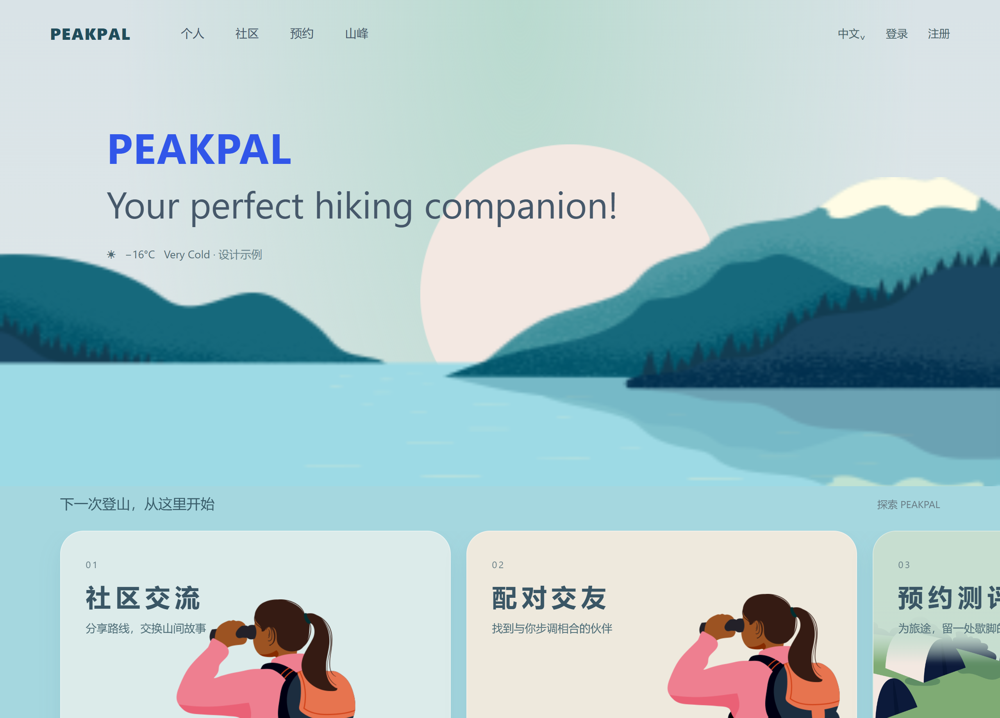
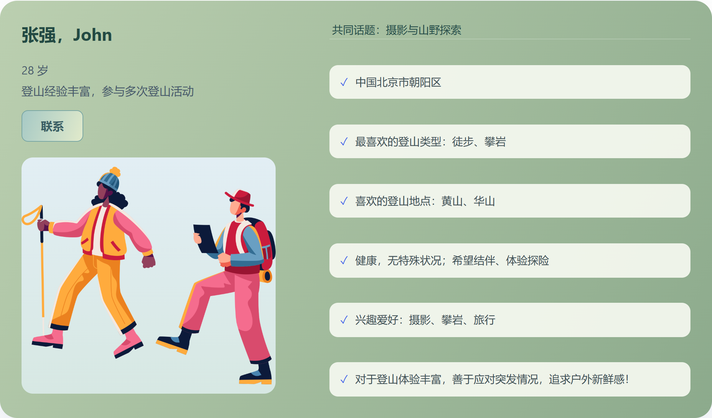
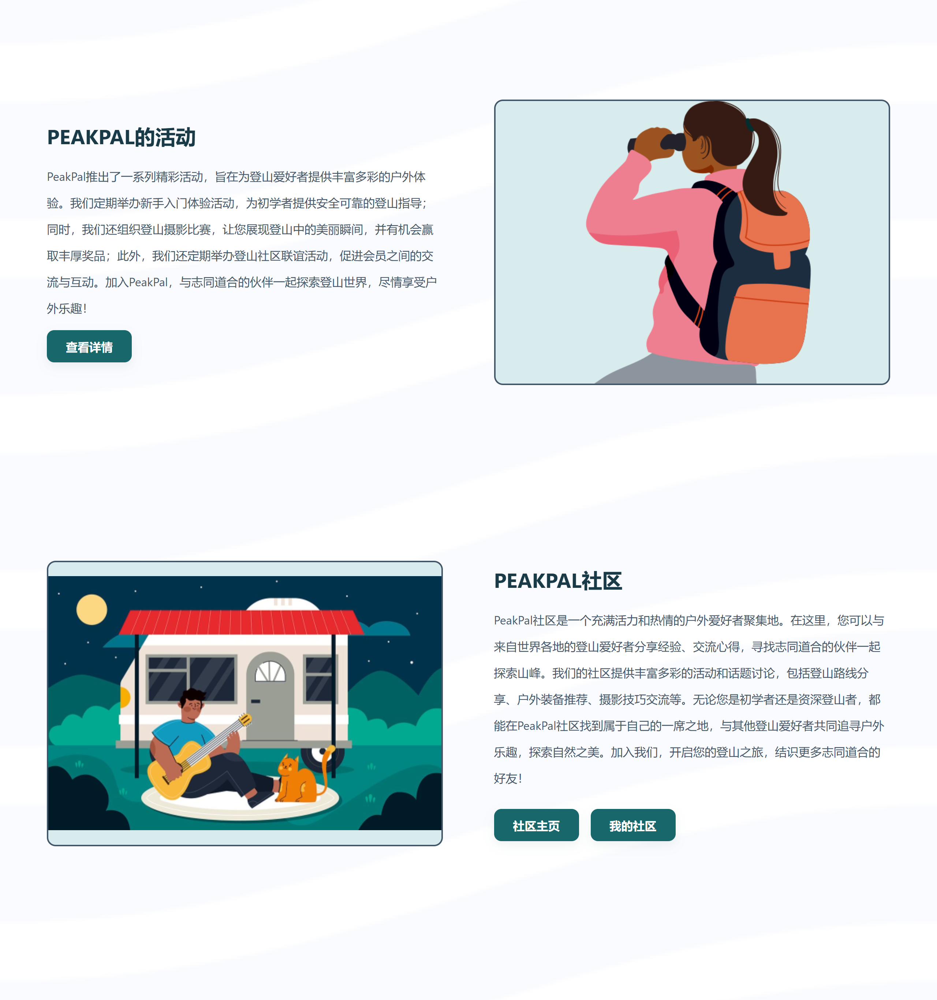
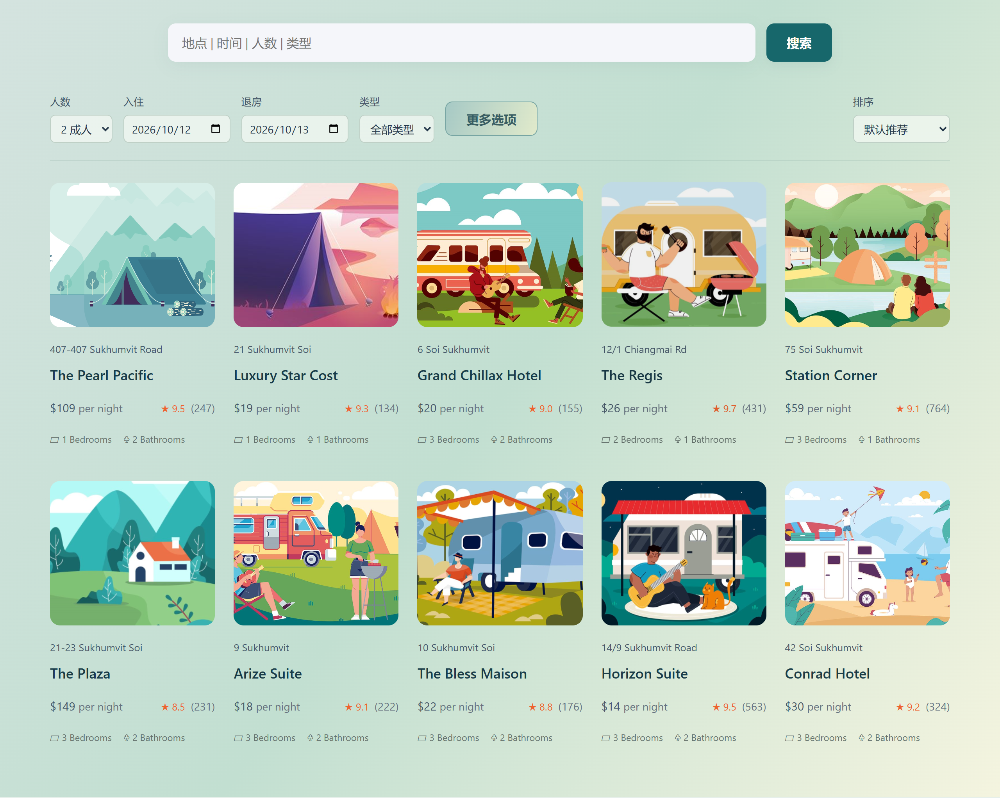
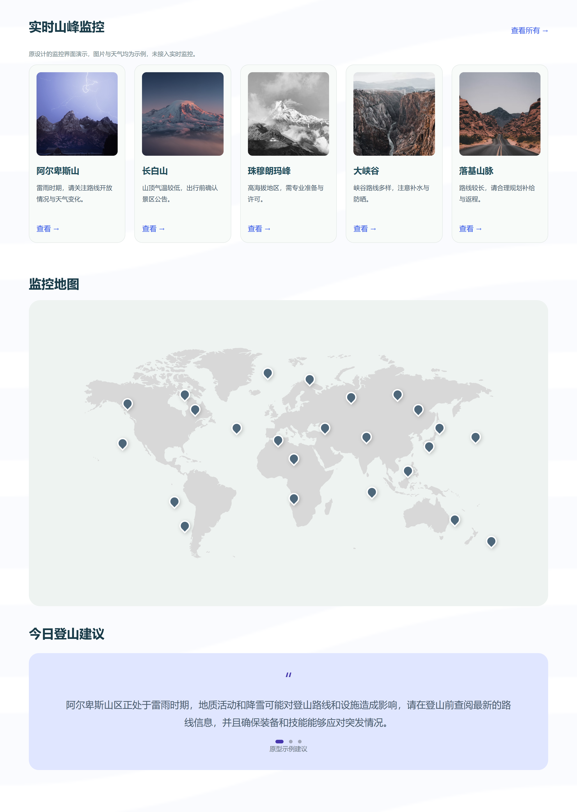

### 本科作业-peakpal登山者社交网站

PEAKPAL 是本科人机交互课程中的登山社交网站设计，围绕寻找同行伙伴、交流登山经验和安排出行展开。用户填写登山经历、兴趣和活动期待后，可以浏览伙伴并发起交流，在社区发布动态、查看个人行程，也可以选择营地、填写预约信息和查看山峰信息。项目以山野插画、湖蓝与草木绿为主要视觉元素，将社交与出行服务放在同一套页面中。

本目录保留原始 Figma 设计及演示视频，并收录后续整理的作品集和可运行网页。原始设计的页面与交互以 Figma 为准；网页在保留主要流程的基础上，对图片衔接、排版和移动端展示作了调整。

#### 阅读顺序

| 材料 | 内容 | 阅读入口 |
| --- | --- | --- |
| 作品集 | 项目概览、资料设置、伙伴配对、个人中心、社区交流、营地预约、山峰观测、移动适配 | [PPT · 8页](./作品展示/PEAKPAL作品集.pptx) |
| 演示视频 | 原课程设计的操作演示，约 1分20秒 | [MP4 · 下载观看](./作品展示/PEAKPAL.mp4) |
| 交互设计 | 查看完整页面、图层与原型 | [Figma 在线文件](https://www.figma.com/design/0m8klx7ZsQuGsBWmUaTpnT/PEAKPAL?node-id=0-1) · [本地源文件](./设计源文件/PEAKPAL.fig) |
| 网页实现 | 可运行的页面、交互和图片素材 | [网站源码](./网站源码/) · [在线预览](https://peakpal-hiking-0907.zyyjulia030814.chatgpt.site) |

#### 页面预览

| 伙伴配对 | 社区交流 |
| --- | --- |
|  |  |

| 营地预约 | 山峰观测 |
| --- | --- |
|  |  |

[更多页面截图](./页面截图/)

#### 文件说明

视频由原始 `PEAKPAL.mp4` 压缩为 H.264 MP4，保留完整内容与声音，便于下载和播放。网站为前端交互演示，资料、聊天和模拟订单保存在当前浏览器，未接入真实消息、支付或监控服务。在线预览可能需要访问权限，也可下载源码后在本地运行。
